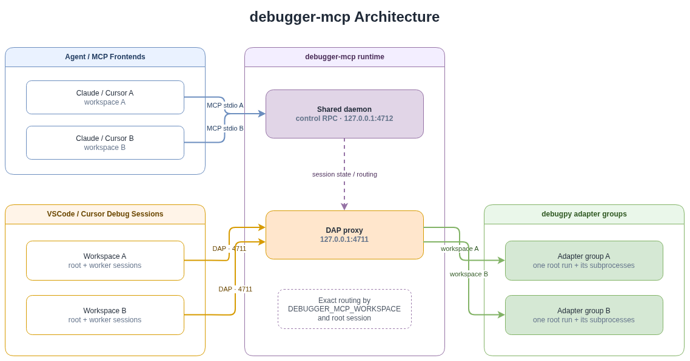

**English** | [简体中文](README.zh-CN.md)

# debugger-mcp

A lightweight runtime-debugging MCP for Claude Code, Cursor, VSCode/Cursor Debug, and debugpy.

## Design Philosophy

The design goal is human–agent collaboration: users start debugging in VSCode/Cursor, set the initial breakpoint, and observe execution; the Agent reads the real call stack and variables, runs Python directly in the paused process for experiments, visualization, and validation, and controls stepping or running to a target line when authorized.

## Architecture

[](docs/assets/debugger-mcp-architecture.drawio)

The only externally exposed DAP port is `4711`. The daemon routes sessions using `DEBUGGER_MCP_WORKSPACE` from the launch/attach request `env` together with its internal root-session marker.

Why not share one debugpy adapter across every project? A debugpy adapter accepts only one independent `launch` root; later connections to that adapter generally must be subprocess `attach` sessions belonging to that root. Since v0.6.0, debugger-mcp uses:

```text
one independent root debug run → one adapter
all subprocesses of that root → the same adapter
```

This supports multiple projects running in parallel while preserving debugpy `subProcessId` registration and automatic torchrun worker discovery.

## Installation

### Let Any Agent Do It (Recommended)

Installation and configuration can be delegated to any Agent. You only need to:

1. Clone this repository.
2. Tell the Agent the absolute path to this repository in chat.

For example:

```text
Using /absolute/path/to/debugger-mcp/README.md, install debugger-mcp and configure MCP, VSCode debugging, and the Agent Skill for me.
```

After reading this README, the Agent can complete all installation and configuration steps below. You do not need to copy configuration manually; review the result after the Agent finishes.

### Manual Installation

```bash
cd /path/to/debugger-mcp
python -m pip install -e . --no-build-isolation
```

Verify the installation:

```bash
python -c "import debugger_mcp; print(debugger_mcp.__version__); print(debugger_mcp.__file__)"
```

The command should print the installed version and the actual source path.

The Python executable used by the MCP configuration must be the same one in which this source tree is installed.

## Configuration

### MCP Configuration

#### Cursor: Recommended Global Configuration

Cursor supports MCP Roots, so one global configuration is sufficient:

```text
~/.cursor/mcp.json
```

```json
{
  "mcpServers": {
    "debugger": {
      "type": "stdio",
      "command": "/path/to/python",
      "args": ["-m", "debugger_mcp"]
    }
  }
}
```

You do not need to add `DEBUGGER_MCP_WORKSPACE=${workspaceFolder}` to every project's `.cursor/mcp.json`. When Cursor declares the Roots capability during MCP initialization, debugger-mcp requests `roots/list` and uses the single returned root as the frontend workspace.

Note: this automatically identifies the **MCP frontend** workspace. Each `.vscode/launch.json` debug configuration must still include:

```json
"debugServer": 4711,
"env": {
  "DEBUGGER_MCP_WORKSPACE": "${workspaceFolder}"
}
```

#### Claude Code / Other stdio MCP Hosts

Example project-level `.mcp.json`:

```json
{
  "mcpServers": {
    "debugger": {
      "type": "stdio",
      "command": "/path/to/python",
      "args": ["-m", "debugger_mcp"]
    }
  }
}
```

Windows path example:

```json
"command": "D:\\Softwares\\anaconda3\\python.exe"
```

Linux path example:

```json
"command": "/home/lin/miniconda3/bin/python"
```

### VSCode Debug Configuration

#### Regular Single Process

```json
{
  "name": "Python through debugger-mcp",
  "type": "debugpy",
  "request": "launch",
  "program": "${file}",
  "console": "integratedTerminal",
  "justMyCode": true,
  "debugServer": 4711,
  "env": {
    "DEBUGGER_MCP_WORKSPACE": "${workspaceFolder}"
  }
}
```

The proxy consumes `env.DEBUGGER_MCP_WORKSPACE` and removes it before forwarding the request, so it never enters the debuggee process. Other `env` entries are preserved and forwarded to debugpy. `cwd` is recorded only as the diagnostic field `launch_cwd`.

If the configuration already has an `env` object, merge the marker into that object. Do not define two `env` keys in JSON:

```json
"env": {
  "PYTHONWARNINGS": "ignore",
  "DEBUGGER_MCP_WORKSPACE": "${workspaceFolder}"
}
```

#### torchrun / DDP

```json
{
  "name": "train debug ddp",
  "type": "debugpy",
  "request": "launch",
  "program": "/usr/local/bin/torchrun",
  "console": "integratedTerminal",
  "justMyCode": false,
  "python": "python",
  "cwd": "${workspaceFolder}/projects",

  "debugServer": 4711,
  "env": {
    "PYTHONWARNINGS": "ignore",
    "DEBUGGER_MCP_WORKSPACE": "${workspaceFolder}"
  },
  "subProcess": true,

  "args": [
    "--nproc_per_node", "1",
    "--node_rank", "0",
    "--nnodes", "1",
    "--master_addr", "127.0.0.1",
    "--master_port", "28537",
    "tools/train.py",
    "cfg.py"
  ]
}
```

The proxy injects the following values into VSCode/debugpy internal `startDebugging` child sessions and consumes the workspace marker again after each child session connects:

```text
debugServer=4711
DEBUGGER_MCP_WORKSPACE=<root workspace>
parent/root session marker
```

This returns each worker to its project's adapter group instead of routing it into another project.

#### Multiple Ranks

When several workers exist, call:

```text
attach_debugpy
```

`attach_debugpy` can diagnose workers by `session_id / process_id / subprocess_id / process_name / debug_state`. `evaluate` does not expose `session_id`; it always targets the latest genuinely stopped session in the current workspace. To inspect a specific worker, make that worker the current stopped session or use a diagnostic/read tool that still supports explicit session selection.

Confirm the rank of the automatically selected worker:

```text
evaluate(expression="__import__('os').environ.get('LOCAL_RANK')")
```

### Agent Skill

The source package includes the official Skill:

```text
claude-skill/debugger-mcp/SKILL.md
```

It contains a runtime-first trigger rule: when the user explicitly says the program has hit a breakpoint, is paused, or asks for a current runtime value, the Agent must call debugger-mcp before using Grep/Read.

Install it:

Windows：

```powershell
New-Item -ItemType Directory -Force "$HOME\.claude\skills\debugger-mcp" | Out-Null
Copy-Item ".\claude-skill\debugger-mcp\SKILL.md" "$HOME\.claude\skills\debugger-mcp\SKILL.md" -Force
```

Linux：

```bash
mkdir -p ~/.claude/skills/debugger-mcp
cp claude-skill/debugger-mcp/SKILL.md ~/.claude/skills/debugger-mcp/SKILL.md
```

Fully exit and restart Claude Code after replacing the Skill.

## Usage

After completing the installation and MCP/VSCode configuration above:

1. Select the desired debug configuration in the VSCode/Cursor **Run and Debug** panel.
2. Set a breakpoint where you want to inspect the program, press **F5**, and wait for execution to pause.
3. Tell the Agent in chat that the program is paused and discuss the current runtime directly. You can ask it to inspect locals, the call stack, or object structure; run temporary calculations; validate a hypothesis; or visualize and save runtime data.
4. To move execution, ask the Agent to use `step_over`, `step_into`, `step_out`, or `run_to_line`. Running to a line in another file requires explicit user authorization.

The user always decides which debug task to start, where to set the initial breakpoint, and whether the Agent may control execution. The Agent reads and operates on the real paused runtime.

## Further Documentation

- [Tool Guide](TOOLS.md)
- [Release Notes](RELEASE_NOTES.md)

## Upgrading from an Older Version

Pull the latest source and reinstall:

```bash
python -m pip install -e . --no-build-isolation
```

No manual daemon handling is required after installation:

```text
same daemon version → reuse it
different daemon version → replace it with the installed version
```

You do not need to stop VSCode debugging first or manually free ports 4711/4712. If replacing the daemon disconnects an existing debug session, press F5 again in VSCode.

Every project's `launch.json` must still include:

```json
"env": {
  "DEBUGGER_MCP_WORKSPACE": "${workspaceFolder}"
}
```

Do not use the invalid top-level field `debuggerMcpWorkspace`. Do not rely on `cwd` for automatic matching; debugger-mcp treats it as diagnostic information rather than a routing key.

## Verification and Troubleshooting

### Connection Check

Claude Code：

```text
/mcp
```

Expected:

```text
debugger · connected · 10 tools
```

After hitting a breakpoint, call:

```text
attach_debugpy
```

The result should include:

```text
client_workspace
workspace_session_count
selected_session_id
sessions
```

By default, `get_locals()` should return compact text, and `evaluate()` should return only the expression result.

### Daemon Log

Windows：

```powershell
Get-Content "$env:TEMP\debugger-mcp-daemon.log" -Tail 100
```

Linux：

```bash
tail -n 100 /tmp/debugger-mcp-daemon.log
```

## Development Tests

```bash
pytest -q
python tests/integration_smoke.py
python tests/integration_v040.py
python tests/integration_run_to_line_timeout.py
python tests/integration_subprocess.py
python tests/integration_sequential.py
python tests/integration_workspaces.py
python tests/integration_torchrun.py
```

Coverage includes:

- `get_stack` returning the complete frame set by default, `get_locals` retaining every local name, `evaluate` returning the complete result, and `full=true` genuinely preserving all fields;
- two Claude frontends sharing one daemon;
- two independent workspaces running root launches concurrently while each reads its own stopped session by default;
- explicit cross-project reads with `session_id`;
- automatic root + subprocess routing;
- real torchrun rank workers;
- repeated F5 launches;
- `inspect_structure` limits;
- `run_to_line`, preservation of user breakpoints, timeout cleanup, and cross-file authorization.
