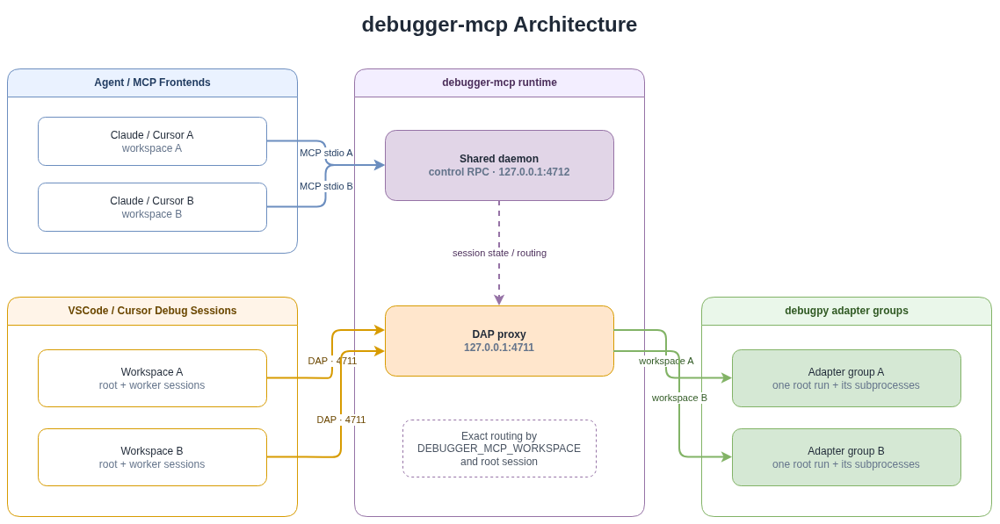

[English](README.md) | **简体中文**

# debugger-mcp

面向 Claude Code、Cursor、VSCode/Cursor Debug 和 debugpy 的轻量运行时调试 MCP。

## 设计哲学

设计目标是“人机共驾”：用户在 VSCode/Cursor 中启动调试、设置初始断点并观察执行位置；Agent 读取真实调用栈和变量，并直接在暂停现场执行 Python、做运行时实验/可视化/验证，在获得相应权限后控制单步或运行到目标行。

## 架构

[](docs/assets/debugger-mcp-architecture.drawio)

外部只使用一个固定 DAP 端口 `4711`。daemon 根据 launch/attach 请求的 `env` 中的 `DEBUGGER_MCP_WORKSPACE` 和内部 root-session 标记完成路由。

为什么不是所有项目共用一个 debugpy adapter：debugpy adapter 只允许一个独立的 `launch` root；同一 adapter 后续连接通常必须是该 root 的 subprocess `attach`。因此 v0.6.0 使用：

```text
一个独立 root debug run → 一个 adapter
该 root 的所有 subprocess → 继续共享这个 adapter
```

这样既支持多个项目并行启动，也保留 debugpy 的 `subProcessId` 注册和 torchrun worker 自动发现。

## 安装

### 交给 Agent 完成（推荐）

安装与配置环节可以直接交给任何 Agent 完成。用户只需要：

1. 克隆本项目；
2. 在聊天框中告诉 Agent 本项目的绝对路径。

例如：

```text
请根据 /absolute/path/to/debugger-mcp/README.md，帮我完成 debugger-mcp 的安装、MCP 配置、VSCode 调试配置和 Agent Skill 配置。
```

Agent 读取本项目 README 后，即可按照下面的说明完成全部安装与配置。用户不需要手工复制配置；只需在 Agent 修改完成后检查结果。

### 手动安装

```bash
cd /path/to/debugger-mcp
python -m pip install -e . --no-build-isolation
```

验证：

```bash
python -c "import debugger_mcp; print(debugger_mcp.__version__); print(debugger_mcp.__file__)"
```

应输出当前安装版本和实际源码路径。

MCP 配置使用的 Python 必须是安装了该源码的同一个 Python。

## 配置

### MCP 配置

#### Cursor：推荐全局配置

v0.6.3 起支持 Cursor 的 MCP Roots，因此可以只配置一次：

```text
~/.cursor/mcp.json
```

```json
{
  "mcpServers": {
    "debugger": {
      "type": "stdio",
      "command": "/path/to/python",
      "args": ["-m", "debugger_mcp"]
    }
  }
}
```

不需要在每个项目的 `.cursor/mcp.json` 中再写 `DEBUGGER_MCP_WORKSPACE=${workspaceFolder}`。只要 Cursor 在 MCP initialize 中声明 Roots capability，debugger-mcp 会主动请求 `roots/list` 并把单一 root 作为当前 frontend workspace。

注意：这是 **MCP frontend** 的 workspace 自动识别。调试配置的 `.vscode/launch.json` 仍需：

```json
"debugServer": 4711,
"env": {
  "DEBUGGER_MCP_WORKSPACE": "${workspaceFolder}"
}
```

#### Claude Code / 其他 stdio MCP 宿主

项目 `.mcp.json` 示例：

```json
{
  "mcpServers": {
    "debugger": {
      "type": "stdio",
      "command": "/path/to/python",
      "args": ["-m", "debugger_mcp"]
    }
  }
}
```

Windows 路径示例：

```json
"command": "D:\\Softwares\\anaconda3\\python.exe"
```

Linux 路径示例：

```json
"command": "/home/lin/miniconda3/bin/python"
```

### VSCode 调试配置

#### 普通单进程

```json
{
  "name": "Python through debugger-mcp",
  "type": "debugpy",
  "request": "launch",
  "program": "${file}",
  "console": "integratedTerminal",
  "justMyCode": true,
  "debugServer": 4711,
  "env": {
    "DEBUGGER_MCP_WORKSPACE": "${workspaceFolder}"
  }
}
```

`env.DEBUGGER_MCP_WORKSPACE` 由代理消费并在转发前移除，不会进入被调试程序；其他 `env` 项保持不变并继续传给 debugpy。`cwd` 仅记录为诊断字段 `launch_cwd`。

如果原配置已经有 `env`，把标记合并进同一个对象；JSON 里不要写两个 `env` 键：

```json
"env": {
  "PYTHONWARNINGS": "ignore",
  "DEBUGGER_MCP_WORKSPACE": "${workspaceFolder}"
}
```

#### torchrun / DDP

```json
{
  "name": "train debug ddp",
  "type": "debugpy",
  "request": "launch",
  "program": "/usr/local/bin/torchrun",
  "console": "integratedTerminal",
  "justMyCode": false,
  "python": "python",
  "cwd": "${workspaceFolder}/projects",

  "debugServer": 4711,
  "env": {
    "PYTHONWARNINGS": "ignore",
    "DEBUGGER_MCP_WORKSPACE": "${workspaceFolder}"
  },
  "subProcess": true,

  "args": [
    "--nproc_per_node", "1",
    "--node_rank", "0",
    "--nnodes", "1",
    "--master_addr", "127.0.0.1",
    "--master_port", "28537",
    "tools/train.py",
    "cfg.py"
  ]
}
```

代理会自动把以下信息注入 VSCode/debugpy 的内部 `startDebugging` 子 session，并在子 session 建立后再次消费 workspace 标记：

```text
debugServer=4711
DEBUGGER_MCP_WORKSPACE=<root workspace>
parent/root session marker
```

因此 worker 会回到所属项目的 adapter group，不会串到另一个项目。

#### 多 rank

多个 worker 同时存在时调用：

```text
attach_debugpy
```

`attach_debugpy` 可根据 `session_id / process_id / subprocess_id / process_name / debug_state` 诊断多个 worker。`evaluate` 本身不暴露 `session_id`，始终作用于当前 workspace 最新 genuinely stopped 的 session；若必须检查指定 worker，可先让该 worker 成为当前停点，或使用仍支持显式 session 选择的诊断/读取工具。

确认当前被自动选中 worker 的 rank：

```text
evaluate(expression="__import__('os').environ.get('LOCAL_RANK')")
```

### Agent Skill

源码包内的正式 Skill：

```text
claude-skill/debugger-mcp/SKILL.md
```

它包含 runtime-first 强触发规则：用户明确说程序已命中断点、已经暂停或要求查看当前运行时值时，Agent 必须先调用 debugger MCP，而不能先 Grep/Read。

安装：

Windows：

```powershell
New-Item -ItemType Directory -Force "$HOME\.claude\skills\debugger-mcp" | Out-Null
Copy-Item ".\claude-skill\debugger-mcp\SKILL.md" "$HOME\.claude\skills\debugger-mcp\SKILL.md" -Force
```

Linux：

```bash
mkdir -p ~/.claude/skills/debugger-mcp
cp claude-skill/debugger-mcp/SKILL.md ~/.claude/skills/debugger-mcp/SKILL.md
```

替换后完全退出并重启 Claude Code。

## 使用方法

完成上述安装及 MCP、VSCode 配置后：

1. 在 VSCode/Cursor 的 **Run and Debug** 面板中选择要使用的 debug 配置。
2. 在需要观察的位置设置断点，然后按 **F5** 启动调试，等待程序停在断点。
3. 在聊天框中告诉 Agent 程序已经暂停，并直接讨论当前 runtime。例如，可以要求 Agent 查看局部变量、调用栈和对象结构，执行临时计算，验证假设，或把运行时数据可视化并保存为文件。
4. 需要移动执行位置时，可以要求 Agent 使用 `step_over`、`step_into`、`step_out` 或 `run_to_line` 控制执行流。跨文件运行到指定行需要用户明确授权。

用户始终决定启动哪个调试任务、在哪里设置初始断点，以及是否允许 Agent 控制执行流；Agent 基于真实暂停现场读取和操作 runtime。

## 延伸阅读

- [工具介绍](TOOLS.zh-CN.md)
- [版本记录](RELEASE_NOTES.zh-CN.md)

## 从旧版本升级

拉取最新源码后重新安装：

```bash
python -m pip install -e . --no-build-isolation
```

安装完成后无需手动处理 daemon：

```text
daemon 版本相同 → 直接复用
daemon 版本不同 → 直接替换为当前安装版本
```

不需要预先停止 VSCode 调试，也不需要手动清理 4711/4712。旧调试连接如果因替换而断开，在 VSCode 中重新按一次 F5 即可。

仍需在每个项目的 `launch.json` 中加入：

```json
"env": {
  "DEBUGGER_MCP_WORKSPACE": "${workspaceFolder}"
}
```

不要再使用非法的顶层字段 `debuggerMcpWorkspace`。不要依赖 `cwd` 自动匹配；v0.6.0 会把它当作诊断信息，而不是路由依据。

## 验证与排查

### 连接验证

Claude Code：

```text
/mcp
```

预期：

```text
debugger · connected · 10 tools
```

命中断点后调用：

```text
attach_debugpy
```

应看到：

```text
client_workspace
workspace_session_count
selected_session_id
sessions
```

默认 `get_locals()` 应是紧凑文本；默认 `evaluate()` 应只有结果本身。

### daemon 日志

Windows：

```powershell
Get-Content "$env:TEMP\debugger-mcp-daemon.log" -Tail 100
```

Linux：

```bash
tail -n 100 /tmp/debugger-mcp-daemon.log
```

## 开发测试

```bash
pytest -q
python tests/integration_smoke.py
python tests/integration_v040.py
python tests/integration_run_to_line_timeout.py
python tests/integration_subprocess.py
python tests/integration_sequential.py
python tests/integration_workspaces.py
python tests/integration_torchrun.py
```

覆盖范围：

- `get_stack` 默认完整 frame 集合、`get_locals` 默认完整 local 名称集合、`evaluate` 完整结果，以及真正不裁字段的 `full=true`；
- 两个 Claude 前端共享同一 daemon；
- 两个独立 workspace 同时运行 root launch，并各自默认读取自己的停点；
- 显式 `session_id` 跨项目读取；
- root + subprocess 自动路由；
- 真实 torchrun rank worker；
- 连续多次 F5；
- `inspect_structure` 限制；
- `run_to_line`、用户断点保留、超时后台清理和跨文件授权。
